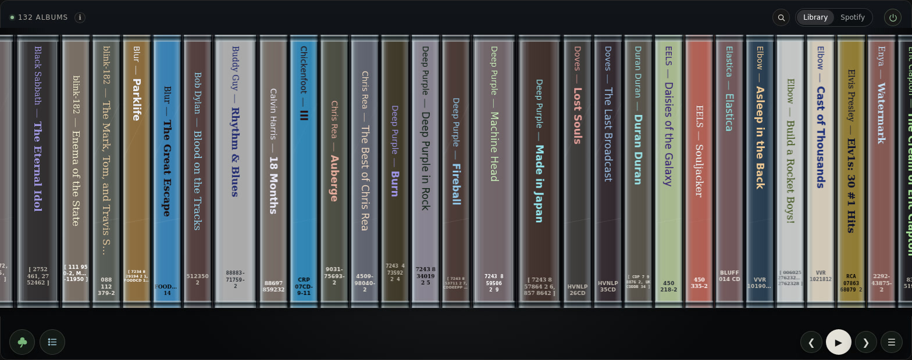

[Watch the short feature tour](assets/lyrion-carousel-feature-tour.mp4)

[](https://buymeacoffee.com/stuliet)

# Lyrion Carousel

Lyrion Carousel is a standalone album-browsing and playback-control interface for Lyrion Music Server (LMS). Browse the library as a circular shelf of CD spines or a fan of jewel-case covers. Both displays use CSS transforms; no WebGL renderer or remote font downloads are required.

Current application version: **0.11.0**. The canonical version is stored in [`VERSION`](VERSION). Do not change the application version as part of ordinary development work; it is changed only when explicitly requested.

## Features

- connected LMS/Squeezebox/Squeezelite player discovery and selection;
- circular CD shelf with artwork-derived spine colours, stable readable font choices, and configurable displayed-album count;
- saved Shelf/Fan display style and server-prepared artist/album, album-only, colour or random ordering; random order is retained across library refreshes within the session;
- startup directly on the currently playing album, or a randomly selected display album when nothing is playing;
- server-prepared catalogue ordering using bounded LMS pages, with only nearby albums rendered; a 15-minute persistent catalogue snapshot avoids rescanning LMS for every sort or genre-filter change;
- paged album-ID → `sort:artflow` position index for direct jumps, plus validated in-memory ID-to-index lookups during animation;
- persistent server-side artwork and spine metadata cache, plus resized covers (128–1024 px); local spine metadata is fetched in 64-ID batches, with at most two concurrent batches and a bounded browser-side metadata LRU;
- browser-side caching of read-only LMS discovery and album RPCs; prepared ordering requires LMS connectivity;
- event-driven library refresh after LMS scans complete, invalidating the server catalogue snapshot before reloading;
- album/artist search and A–Z navigation;
- shamrock random-album selection with configurable animation duration;
- click/tap a spine to preview its realistic closed cover; drag/swipe the cover left or right to scroll spines without opening the next cover; the playing album stays enlarged throughout scrolling and automatic idle return, while clicking a spine can temporarily preview another album; long-press the cover for the album menu (including Album Information), or use its separate play button to start playback;
- long-press a cover to clear the playlist and play it, play it now, play it after the current album, add it to the queue, or open Album Information;
- LMS CometD long-polling for live playback and server/library state;
- current track, track number and locally advancing progress display;
- compact previous, play/pause and next-track controls;
- configurable application screen sleep with touch-to-wake protection against accidental commands;
- swipe-up play queue with current-track highlighting and direct track selection;
- configurable idle return that scrolls back to the playing album without closing or reopening its enlarged cover, bounded by the maximum scroll duration;
- permanently enlarged playing cover that moves with its album during scrolling;
- saved player selection across browser sessions;
- live configurable display count, preview/menu timeouts, idle return and maximum scroll duration;
- Settings panel with explicit LMS, CometD/live-update, player, library, cache and application status;
- automatic LMS reconnection;
- Library / Spotify source switching with Spotify saved albums supplied through LMS Spotty;
- full Spotify album search through Spotty, with searched albums playable and savable to the Spotify library;
- source-aware now-playing navigation and Spotify artwork rendered with the same jewel-case presentation as local albums;
- Album Information for local and Spotify albums, including genre when the upstream metadata provides it;
- installable/fullscreen-friendly web-app metadata and application icon;
- zero-idle-loop long-task performance diagnostics.

## Source layout

```text
lyrion-carousel/
├── VERSION
├── index.html
├── manifest.webmanifest
├── assets/
├── css/
├── docs/
│   ├── spotify-spotty.md
│   └── wall-controller.md
├── js/
├── packaging/debian/
├── spotty-diagnostic.html
├── tests/
├── server.py
└── README.md
```

There is no Node/npm runtime dependency and no build step. Python 3.9+ and Pillow are required; the Debian package installs `python3-pil`. `server.py` serves the client files and provides the required LMS/CometD/artwork API proxies and artwork cache.

## Run directly

On Debian/Ubuntu, install the image dependency first with `sudo apt install python3-pil`. On other systems install Pillow into your Python environment.

```bash
cd lyrion-carousel
python3 server.py
```

Open `http://127.0.0.1:8088/`. For trusted-LAN access:

```bash
python3 server.py --bind 0.0.0.0
```

`0.0.0.0` is a listening address, not a browser destination. Do not expose this server directly to the internet.

## Runtime options

| Option | Default | Purpose |
| --- | ---: | --- |
| `--lms` | `http://streamer:9000` | Lyrion Music Server base URL |
| `--bind` | `127.0.0.1` | Controller listening address |
| `--port` | `8088` | Controller HTTP port |
| `--cache-dir` | `.cache/album-art` | Persistent album cache location |
| `--cache-limit-mb` | `512` | Initial soft artwork-cache limit, adjustable from the browser |
| `--cache-hard-limit-mb` | `2000` | Server-only ceiling for browser cache-limit changes |
| `--clear-cache` | off | Delete cached artwork, resized covers and metadata before starting |
| `--batch-size` | `40` | Albums per browser fallback/index request (server ordering uses 200) |
| `--idle-return-seconds` | `30` | Default inactivity before returning to now playing; `0` disables |
| `--reconnect-max-seconds` | `30` | Maximum reconnect delay |
| `--random-scroll-max-seconds` | `3` | Maximum random/startup/idle-return scroll duration |
| `--search-limit` | `100` | Maximum albums returned by a search |

Settings are grouped into Display, Playback, Connection, Genres, Cache, About and Coffee tabs. Changes apply immediately and are saved in this browser. They include LMS URL, player, idle return, menu/preview timeouts, maximum scroll duration, displayed albums, display style, cover resolution and keeping the playing cover open. The Cache tab can adjust the soft artwork-cache limit up to the server-configured hard limit. The obsolete carousel-density control has been removed; use Displayed albums to set spine width and spacing.

The server URL is shared runtime state on the proxy. Set `LMS_URL` in `/etc/default/lyrion-carousel` for a persistent machine-wide default. Saved browser choices override server defaults; the saved LMS URL is applied before initial discovery.

## Startup and browsing behaviour

Startup discovers players and loads the catalogue. If an album is playing, the shelf scrolls to it and opens its cover. Otherwise it scrolls to a random position without opening a cover or sending a playback command. Startup, random selection and idle return use the maximum scroll duration from Settings.

After the idle delay, the shelf returns to the playing album and opens its cover. Its preview does not time out. With **Keep playing album open** enabled (the default), it stays open while scrolling and moves with its position on the shelf; it can move offscreen and return as you browse. Clicking another spine temporarily previews that album; closing it or letting its preview time out restores the playing cover. When playback changes to another album, the shelf follows and opens the new cover. Turn the option off to restore click-to-close and scroll-to-dismiss behaviour; idle return will still open the playing cover.

A short click on an ordinary preview or the surrounding shelf closes it. Hold a spine or cover for roughly half a second to open album actions. The cover’s play button loads that album. Search, Settings and Album Information appear above the shelf, and their input controls do not navigate the shelf.

The detail area shows the album under the pointer; outside the shelf it shows the playing album, or clears when nothing is playing. Track details and progress appear only for the playing album. The heading stays at the same vertical position in both states.

## Display style and cover resolution

**Settings → Display style** switches immediately between Shelf (default) and Fan. The choice is saved per browser; both share ordering, playback and cover controls. Displayed albums controls shelf density; the fan keeps a bounded window of nearby cases.

**Settings → Album cover size** selects 128, 256, 384, 512 (default), 768 or 1024 pixels. This controls image resolution, not the displayed case size. Server-generated JPEG variants preserve aspect ratio and never upscale. Originals remain available for spine-colour calculation.

**Settings → Cache → Clear album cache** uses an inline confirmation and removes artwork, resized covers and derived colours, fonts and colour indexes. Metadata rebuilds as needed; colour ordering prepares it for the whole library. The Cache tab starts at a 512 MB soft limit by default; the browser may raise or lower it, but never above the server-only 2 GB hard limit. Set `CACHE_LIMIT_MB` and `CACHE_HARD_LIMIT_MB` in `/etc/default/lyrion-carousel` (or pass the corresponding command-line options) before starting the service to change those defaults.

## Colour ordering

Choose **Colour** in the album-order menu to arrange spines from red through yellow, green, blue and violet. Nearly neutral colours follow, dark to light; albums with unavailable artwork sort last. Equal colours are ordered by artist and title. The choice persists across reloads and catalogue refreshes.

The server derives a numeric `colour_index` from each cached spine colour and upgrades older metadata without refetching artwork. The first colour sort may take longer while metadata is gathered for the whole library, using six shared server workers while the browser shows a preparation message. Subsequent sorts reuse cached metadata. Changing any sort order immediately centres and opens the playing album once the new catalogue is ready; otherwise it preserves the selected album.

## Shelf rendering and metadata

Artwork is fetched through `/api/art/<artwork-id>` and cached on disk. `/api/art-meta/<artwork-id>` supplies `spine_color`, `text_color`, `spine_font` and `colour_index`; existing colour-only caches upgrade automatically. Fonts are chosen deterministically from local sans-serif and serif stacks. Actual typefaces depend on the fonts installed on the display device.

Labels scale with spine width, truncate with an ellipsis and retain their full text on hover. Colour is inset from the clear end caps, with additional text padding. Open covers and their gaps share the album’s scrolling position. Browser artwork URLs include the LMS identity to avoid reusing another server’s artwork with the same ID.

## Catalogue loading, persistence and outages

`/api/catalogue?order=artistAlbum|album|colour|random` reads LMS in pages of up to 200 albums and returns the full ordered catalogue. Colour order includes prepared spine metadata, calculated using six shared server workers. The browser receives the prepared order and renders nearby albums. Catalogue records are fetched again when ordering or refreshing; the catalogue itself is not persistently cached on the server.

Browser fallback/index requests remain bounded by `--batch-size`. `js/resilience.js` caches successful read-only `players` and `albums` RPC responses in local storage; mutating and player-control calls are never replayed. This cache does not cover `/api/catalogue`, so a fresh load or sort change still requires LMS connectivity. An already loaded catalogue can remain visible during an outage while reconnection is attempted.

CometD subscribes to player status and LMS `serverstatus`. When a library scan completes, Lyrion Carousel refreshes the catalogue, album count and position index once. Status/About reports LMS connectivity and CometD/live-update state separately.

### Reconnect acceptance check

Before deployment to a dedicated controller, exercise this sequence against the real LMS installation: start Lyrion Carousel and browse enough of the library to populate browser/artwork caches; stop LMS; confirm previously cached catalogue/artwork remains browsable and playback controls fail safely; restart LMS; confirm the connection and live-update indicators recover and playback commands work again without reloading the page. This is an integration test and cannot be considered passed until run against the actual LMS service.

## Performance

### Rendering optimisations

The carousel uses compositor-friendly CSS transforms and renders only a bounded window of albums. Phase 4 **recycles existing spine, label and shell DOM nodes** as the visible window advances, rather than rebuilding every visible spine. Metadata callbacks check album identity before updating reused nodes; width and font geometry only change when needed, and the open jewel-case width is cached with invalidation on resize and preview transitions. It retains the playing-case pinning and manual preview timeout behaviours.

### Browser performance monitor

The opt-in monitor lives in `js/performance.js` and is exposed as `window.lyrionPerf`. It works in Edge/Chrome DevTools on the controller page (for example `http://streamer:8088`). Normal browsing adds **no extra continuous animation-frame loop, input listeners or DOM MutationObserver**; the monitor starts collecting only when explicitly requested. The existing console warning for main-thread tasks of at least 100 ms remains available when supported.

Open DevTools (**F12 → Console**) and run:

```javascript
lyrionPerf.start({ label: 'Phase 4' });
// Scroll the CD spines for 15–30 seconds, including longer movements.
const phase4 = lyrionPerf.stop();
copy(JSON.stringify(phase4, null, 2));  // Chromium/Edge DevTools copy helper
```

An alternative fixed-duration measurement is:

```javascript
const phase4 = await lyrionPerf.measure({ seconds: 15, label: 'Phase 4' });
copy(JSON.stringify(phase4, null, 2));
```

Start browsing promptly after starting a measurement. Keep the tab in the foreground and use the same viewport, number of visible spines, sort mode and browsing pattern when comparing versions. You may pass `targetFps: 60` to `start()` or `measure()` to impose a fixed budget, but **omitting it is recommended**: the profiler detects the effective refresh rate from foreground `requestAnimationFrame` intervals, including high-refresh displays.

The returned JSON includes:

| Field | Meaning |
| --- | --- |
| `detectedFps`, `effectiveFps`, `frameBudgetMs` | Detected refresh estimate, applied rate and per-frame time budget |
| `sampledFrames`, `estimatedFps`, `frameMs` | Foreground rAF sample count, rate and mean/P95/P99/maximum frame interval |
| `framesOverBudget`, `estimatedDroppedFrames` | Estimated interval overruns relative to the frame budget; **not** actual presented/GPU frame losses |
| `activeScrolling` | Separate sample count, estimated FPS, frame distribution and overruns during carousel wheel/drag/touch/arrow activity plus a 350 ms activity window |
| `suspensions` | Number, total time and longest rAF gaps exceeding 250 ms; excluded from missed-frame and frame-time calculations |
| `longTasks` | Count and total duration of observed main-thread tasks (browser support permitting) |
| `dom` | Initial/final visible spine counts and additions/removals during capture |
| `requests` | Artwork and metadata request counts and reported transferred bytes |
| `heapMB` | Optional Chromium JavaScript heap sizes at start/end |

A `null` value means the browser couldn't establish that metric. Transfer size zero may indicate caching or unavailable transfer timing, **not** proof of zero network traffic. `activeScrolling` is a heuristic for recent user input, not a measurement of exactly which frames displayed a moving shelf. Tab/OS pauses are reported separately, rather than inflating missed-frame estimates.

Compare two captures produced by this version of the profiler using:

```javascript
lyrionPerf.compare(baseline, phase4);
```

The `baseline` and `phase4` variables must contain complete capture objects from equivalent sessions. Earlier reports without `activeScrolling` are not directly comparable on that metric.

### Phase 4 reference measurement (4 November 2026)

A real 36.36-second Edge/Chromium capture while browsing the library reported:

| Metric | Result |
| --- | ---: |
| Detected refresh rate | 142.9 Hz |
| Active scrolling estimated FPS | 143.79 |
| Active scrolling P95 / P99 | 7.0 / 7.1 ms |
| Active scrolling max interval | 7.8 ms |
| Estimated missed frames while active | 0 |
| Overall estimated missed frames | 5 |
| Long tasks / suspensions | 0 / 0 |
| Visible DOM spines (start → finish) | 34 → 34 |
| Spine additions / removals | 12 / 12 |
| JavaScript heap (start → finish) | 2.82 → 2.60 MB |

These are **one browser/session's observations**, not guaranteed results on other hardware, library sizes or display settings. In particular, the capture shows good performance and stable DOM counts, but does not by itself quantify the improvement over an equivalent pre-Phase-4 baseline.

## Web-app / kiosk use

`manifest.webmanifest`, the application icon and fullscreen display metadata allow Lyrion Carousel to behave more like a dedicated appliance when installed/launched from a supporting browser. This does not add a service worker or attempt to cache the application shell; LMS reconnection and catalogue fallback remain explicit application behaviours.

### Raspberry Pi kiosk startup

The Debian package already runs the Lyrion Carousel server under `lyrion-carousel.service`, including automatic restart after a server failure. A separate desktop-session wrapper should therefore manage only Chromium.

For a dedicated controller, set the packaged server to listen locally in `/etc/default/lyrion-carousel`:

```bash
BIND_ADDRESS=127.0.0.1
PORT=8088
```

Apply the change:

```bash
sudo systemctl restart lyrion-carousel.service
```

Create the kiosk wrapper as `~/.local/bin/start-carousel.sh`:

```bash
#!/usr/bin/env bash

URL="http://127.0.0.1:8088/"
PROFILE="$HOME/.config/lyrion-carousel-kiosk"

while true; do
    # Wait until the local Carousel server is ready.
    until python3 -c "
import urllib.request
urllib.request.urlopen('$URL', timeout=2).read(1)
" >/dev/null 2>&1; do
        sleep 2
    done

    # Run Chromium until it closes or crashes.
    chromium \
        --kiosk \
        --noerrdialogs \
        --no-first-run \
        --disable-session-crashed-bubble \
        --disable-features=TranslateUI \
        --overscroll-history-navigation=0 \
        --user-data-dir="$PROFILE" \
        "$URL"

    sleep 2
done
```

Make it executable:

```bash
chmod +x ~/.local/bin/start-carousel.sh
```

On current Raspberry Pi OS Desktop releases using labwc, enable Desktop Autologin with `sudo raspi-config`, then create the user autostart file without overwriting an existing one:

```bash
mkdir -p ~/.config/labwc
cp -n /etc/xdg/labwc/autostart ~/.config/labwc/autostart
```

Append this line to `~/.config/labwc/autostart`:

```bash
"$HOME/.local/bin/start-carousel.sh" &
```

After reboot, the desktop logs in automatically, waits for Lyrion Carousel on port 8088 and opens it full-screen. If Chromium exits or crashes, the wrapper starts it again after two seconds. Pressing Alt+F4 therefore closes the kiosk only briefly; stop the wrapper over SSH while developing:

```bash
pkill -f start-carousel.sh
pkill -f chromium
```

Keep `BIND_ADDRESS=0.0.0.0` only when the controller must be accessible from other trusted-LAN devices. The server has playback and configuration endpoints without user authentication and must not be exposed directly to the internet.

The planned wall-controller/display hardware is documented separately in [`docs/wall-controller.md`](docs/wall-controller.md).

## Versioning

`VERSION` is the single canonical application version. Settings → Status/About reads it directly. Debian packaging reads the same file by default, so the UI and generated package do not maintain independent version numbers.

The version is deliberately **not** auto-incremented by feature work or packaging. It remains at the value in `VERSION` until an explicit version-change request is made.

## Debian packaging

Build from the repository root:

```bash
packaging/debian/build-deb.sh
```

The package/service names are consistently `lyrion-carousel`:

- package: `lyrion-carousel`;
- service: `lyrion-carousel.service`;
- configuration: `/etc/default/lyrion-carousel`;
- application: `/opt/lyrion-carousel`;
- artwork cache: `/var/cache/lyrion-carousel/artwork`.

The package includes `VERSION`, the web-app manifest, assets, CSS and JavaScript.

### Manage the Debian service

After installation, start the service and enable it to start automatically at boot:

```bash
sudo systemctl enable --now lyrion-carousel.service
```

Use these commands to control the running service:

```bash
sudo systemctl stop lyrion-carousel.service
sudo systemctl start lyrion-carousel.service
sudo systemctl restart lyrion-carousel.service
sudo systemctl status lyrion-carousel.service
```

View recent service output or follow the log while troubleshooting:

```bash
sudo journalctl -u lyrion-carousel.service -n 100 --no-pager
sudo journalctl -u lyrion-carousel.service -f
```

Runtime defaults are stored in `/etc/default/lyrion-carousel`. After changing that file, restart the service to apply the new values:

```bash
sudo systemctl restart lyrion-carousel.service
```

To prevent the service from starting at boot and stop it immediately:

```bash
sudo systemctl disable --now lyrion-carousel.service
```

## Large-library catalogue snapshots

The first cold catalogue request still reads LMS in bounded 200-album pages. Subsequent sort changes reuse the same catalogue, including after restarting Carousel while the snapshot is still fresh. The snapshot lasts up to 15 minutes as a fallback when library events are unavailable. When Carousel observes an LMS scan finishing through the standard CometD server-status stream, **Carousel independently reconciles** its own snapshot against LMS. If album rows have not changed, it preserves the existing unfiltered sort cache and skips rebuilding the browser catalogue. The ripper and LMS do not invoke any Carousel-specific API or hook. Genre-exclusion album IDs are indexed only on first use and saved alongside the snapshot. Non-random prepared orders are retained in a four-entry in-memory response cache; random order is shuffled afresh each time.

The snapshot is stored separately from image files under the existing Carousel cache directory. Clearing the artwork cache also removes catalogue snapshots, but **does not reset the selected LMS server**. **Colour ordering now maintains a separate incremental SQLite index** (at `/var/cache/lyrion-carousel/artwork/colour-index-v1-*.sqlite3` for the packaged service). Every batched spine-metadata response can add newly discovered colours. Switching to colour order processes only artwork whose colour is not yet indexed, then saves the additional rows in a single SQLite transaction. Entries survive service restarts and do **not** require rewriting the entire catalogue JSON snapshot on each scroll. The `/api/catalogue/status` response reports `colour_indexes` for the current LMS.

**Automatic indexing of newly added albums:** after detecting an actual catalogue change, Carousel queues newly introduced artwork IDs for a single low-priority background worker. The worker yields to recent browser artwork/metadata activity and shares the existing cache-clear coordination lock; it saves successful colours in the same persistent SQLite index. When the browser switches to Spotify, the catalogue can still be reconciled without forcing the Spotify UI to reload. An offline Carousel may instead discover changes after its normal snapshot expiry. **Cold-start limitation:** if covers have never been viewed or analysed and no prior snapshot was available, a first colour sort can still take time. Failed background artwork requests are retried through normal metadata access or a later colour sort, and an in-progress background queue does not survive a Carousel process restart.

### LMS URL across service restarts

The installed systemd service uses `LMS_URL` from `/etc/default/lyrion-carousel` as the **initial fallback** (currently `http://streamer:9000`). Once the Connection settings page selects another LMS, Carousel now writes that choice to `/var/cache/lyrion-carousel/lyrion-carousel-lms.json` (the parent of the configured `CACHE_DIR`). The saved server takes precedence on subsequent restarts, even before any browser reconnects. It is deliberately outside the artwork cache so Settings → Clear Cache does not remove it.

To use the local LMS on the streamer, change its URL in Carousel's Connection settings to `http://streamer:9000` after deploying this version, or POST:

```bash
curl -sS -X POST http://127.0.0.1:8088/api/config/lms \
  -H 'Content-Type: application/json' \
  -d '{"lms_url":"http://streamer:9000"}' | python3 -m json.tool
```

Verify `/api/config` returns `streamer:9000` both before and after restarting `lyrion-carousel.service`. This prevents a restart from silently loading a different LMS's catalogue snapshot.

Inspect the catalogue cache without triggering a new LMS scan:

```bash
curl -s http://127.0.0.1:8088/api/catalogue/status | python3 -m json.tool
```

The `cached` field should be `true` after the catalogue has loaded. To measure the improvement, compare a first cold sort against subsequent sort changes with the browser Network tab and watch the absence of repeated LMS catalogue page requests.

## Server endpoints

`server.py` is intentionally small and is not a general-purpose proxy:

- `/api/lms` → LMS JSON-RPC;
- `/api/cometd` → LMS CometD;
- `/api/catalogue?order=artistAlbum|album|colour|random` → server-prepared ordered catalogue from a disk-backed snapshot (15-minute TTL);
- `/api/catalogue/status` → catalogue state, album and colour counts, plus background-colour indexing progress (GET, never contacts LMS);
- `/api/catalogue/reconcile` → Carousel-owned change check after observing an LMS scan finish (POST). Compares album data, updates snapshot only as necessary, and queues new cover colours in the background;
- `/api/catalogue/invalidate` → explicitly discard the catalogue snapshot (POST), without modifying LMS;
- `/api/art/<artwork-id>?size=512` → cached resized cover; omit size for original artwork;
- `/api/art-meta/<artwork-id>` → cached spine colour, text contrast, font and colour index;
- `/api/art-meta` → prepare metadata for up to 64 artwork IDs (POST);
- `/api/config` → runtime defaults;
- `/api/config/lms` → change the proxy LMS URL (POST);
- `/api/cache/clear` → clear persistent artwork and metadata (POST);
- `/api/cache/warm` → start/cancel background artwork preparation (POST);
- `/api/config/cache` → change the runtime soft artwork-cache limit (POST);
- `/api/spotty-art` → proxy/cache Spotty artwork and optional jewel-case composition;
- `/api/spotty-art-meta` → derive shelf metadata from Spotty artwork;
- `/api/diagnostics/spotty` → inspect the live LMS Spotty menu payload;
- `/api/diagnostics/now-playing` → inspect the raw LMS status used for source-aware now-playing matching.

## Current limitations

- LMS password authentication is not yet implemented.
- Search is capped by `--search-limit` (100 by default).
- Original and resized artwork share a 512 MB image-cache limit; automatic detection of changed covers under the same artwork ID is not implemented.
- Browser catalogue fallback only contains read-only LMS responses previously seen by that browser; it is not an independent mirror of the complete LMS database.
- Final reconnect acceptance still needs to be exercised against the actual LMS installation.
- Final 60 fps/memory acceptance testing still needs to be performed on the intended controller hardware.

## Regression checks

```bash
python3 -m unittest discover -s tests -p 'test_*.py'
node tests/regressions.mjs
```

Node is needed only for the JavaScript regression runner. It uses DOM/event doubles and mocked LMS responses; it does not start playback. It checks catalogue paging, scan events, server-switch isolation, display ordering, startup, pinned covers and details. These checks do not replace real-browser visual/touch checks or the live LMS reconnect acceptance sequence above.

## Upgrading to 0.10.0

Restart the Python server (or the Debian service) and refresh the browser. Version 0.10.0 adds the Spotify/Spotty catalogue source, source-aware now playing, Spotify search and album information, genre controls, and the production realistic jewel-case artwork path. Existing artwork/spine metadata remains reusable; clearing the cache is optional.

Spotify support requires the Spotty plugin to be installed and authenticated in LMS. Carousel does not hold Spotify credentials or stream Spotify directly: playback remains LMS → Spotty → the selected LMS/Squeezelite player.

## Realistic jewel-case rendering

Resized cover requests use `case=realistic-v1`. The server composites artwork beneath `assets/jewel-case-realistic-v1.png` and caches a PNG at the selected resolution. Both local and Spotify fan/open-shelf covers use this presentation. Original artwork still supplies spine colours. The browser adds restrained reflections without a Three.js/WebGL rendering loop.

The browser preloads the focused cover and up to four neighbours on each side, with two low-priority image requests at a time. Queued work follows the latest browsing position, and at most 24 loaded images are retained by the preloader.

### Background artwork preparation

Settings → About → Prepare all artwork starts a server-wide background job at the selected cover resolution. It fetches missing original artwork, calculates spine metadata and caches photographic case images for every distinct artwork ID. One album is processed at a time, with a short pause between albums and a pause after foreground cover requests. Progress, unavailable items and cancellation are shown in Settings. The job continues when the browser closes; it is not automatically resumed after restarting the server. Starting it again reuses completed cached files. Changing the cover resolution requires starting another run for that resolution.

The worker stops at the existing 512 MB image-cache limit instead of evicting earlier prepared artwork. It can therefore stop before completing a large library. Foreground cache pruning still applies. Clearing the cache or changing LMS cancels the job; an in-flight request may take up to its normal timeout to finish. This prepares server files, not an offline browser library. `/api/cache/warm` exposes progress (GET) and start/cancel actions (POST). Restart the server after installing this feature.

## License

Original Lyrion Carousel source code is licensed under the **GNU General Public License, version 3.0 only** (`GPL-3.0-only`). See [LICENSE](LICENSE) for the complete licence text.

Copyright © 2026 Stuart Roberts (for original contributions under the copyright holder's control). Under GPL v3, recipients who distribute modified covered versions must meet the licence's corresponding-source and notice obligations. GPL v3 permits commercial distribution but does not permit distribution of proprietary derivatives contrary to its terms.

**Artwork and third-party assets:** The GPL grant applies only to material for which the project has redistribution rights. Included images, artwork, audio/video demonstrations and third-party materials must be reviewed for licensing before public release; items with separate terms must be documented and may need to be replaced or excluded.
